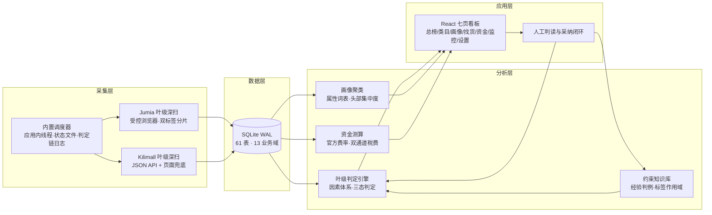
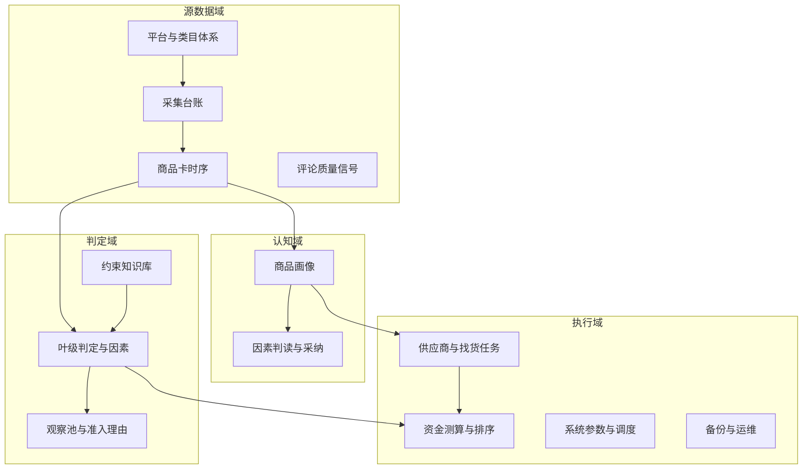

# MarketVane · 肯尼亚电商市场选品罗盘

> A personal decision-support system for cross-border e-commerce market entry — Kenya (Jumia KE / Kilimall KE).
>
> **本仓库只包含架构叙事与设计方法，刻意不包含源代码、判定参数与任何业务数据。** 原因见[边界声明](#边界声明)。

---

## 一句话

回答跨境电商选品的三个问题：**卖什么**（双平台市场扫描与候选筛选）→ **值不值得做**（叶级判定引擎 + 资金测算）→ **找谁供货**（1688 供应商匹配闭环）。

## 业务背景

肯尼亚电商有两个信号可信的平台：Jumia KE 与 Kilimall KE。对个人跨境卖家而言，核心困难不是"没有数据"，而是：

- 平台类目树里**数千个叶子类目，绝大多数不值得看**——容量、竞争、合规各有各的死法；
- 即便找到有量的类目，**不知道该以什么形态切入**（哪个价格带、哪种产品形态、竞争是否已被寡头占死）；
- 国内 1688 货源与肯尼亚售价之间隔着**头程、税费、平台佣金**三座山，拍脑袋算毛利必死。

MarketVane 是单人运营的研究级系统：一台生产采集机每夜自动深扫数百个叶子类目，白天在浏览器里做筛选、判定与资金决策。全程零系统 cron、零云端依赖、单文件数据库。

## 问题拆解：为什么是这五块

系统的模块切分不是按技术层，而是按**决策问题**切的——每一块回答一个独立的问题，输入输出边界清晰：

| # | 模块 | 回答的问题 | 职责边界 |
|---|------|-----------|---------|
| 1 | 市场采集 | 数据从哪来，凭什么信 | 只负责把两个平台的类目榜单逐日扫成结构化卡片，含采集台账（哪天扫了哪个叶、几页、几卡），不负责任何解读 |
| 2 | 叶级筛选判定 | 什么不值得再看一眼 | 对每个叶子类目产出 pass / conditional / excluded 三态判定，且判定结果反哺采集范围（该深扫的深扫、该减量的减量、该停的停） |
| 3 | 商品画像 | 一个细分市场长什么样 | 对存活类目做标题属性聚类（价格带/形态/人群/竞争集中度），产出画像证据链，供人工逐因素判读 |
| 4 | 资金测算 | 值不值得投真金白银 | 用平台官方费率 + 双物流通道税费口径算真实毛利，按资金效率排序候选 |
| 5 | 供应商找货 | 从画像到 1688 报价 | 把画像要素转成找货任务，抓取供应商报价，回填成本后驱动资金测算闭环 |

**这样切的理由**：五块的更新节奏天然不同（采集每日、判定随数据滚动、画像随聚类重算、资金随报价刷新）；每一块都可能单独被推翻重做（比如换平台、换判定逻辑），切开的边界让重做不伤邻接块；最重要的是，人只在一个环节做不可替代的判断——**画像因素的逐项判读与最终采纳**，其余全部自动化。

## 架构

两条值得说的架构原则：

- **判定驱动采集**：不是先采完再分析，而是判定结果直接改写采集器的执行范围与剂量——系统越用越聚焦，废类目的采集成本自动衰减到零；
- **人工裁决是流程节点而不是异常**：画像因素的逐项判读、约束判例的出入库、类目的最终排除，全部落库留痕，前端可见可追溯。

## 数据模型（域级）

13 个业务域、61 张表。这里只给域划分——域的切法本身就是业务理解的产出：

刻意不给字段级 DDL：表名和字段名的粒度会直接暴露判定体系的 mechanics，那是这套系统被真实数据喂出来的部分。

## 工程叙事（结构与协议，不含参数）

- **受控浏览器采集**：CDP 接管有头 Chrome 而非无头模式——无头指纹在 Cloudflare 面前存活不了几轮。验证墙按"检测 → 等待人工点击 → 恢复 / 跳过 / 分级放弃"的协议处理，夜间无人时宁可少采也不硬闯；单叶断点续采幂等，重跑不产生脏数据。
- **内置调度器**：应用内线程 + 状态文件，拒绝系统 cron。决策链全程落日志（拉起/失败原因/异常），曾发生过一次"调度器整夜静默未拉起"的真实事故，根因是子进程僵尸导致探活误判——修复后探活函数能识别僵尸态，这类失败从此必有痕迹。
- **画像生产线**：标题属性聚类产出画像与证据链，但**零人工判读不能采纳**——每个因素必须逐项显式判读"成立"才可能进入采纳状态，守卫拒绝任何跳步。
- **对账纪律**：同一 listing 同日可以合法存在多行（主扫行 + 新品监控行），一切计数按渠道分账；采集台账与落库卡片的每一笔都可对。

## 技术选型与理由

| 层 | 选型 | 为什么 |
|----|------|--------|
| 存储 | SQLite（WAL） | 单人研究级：零运维、单文件好备份、WAL 下采集写与看板读互不阻塞。换 Postgres 的触发条件写得很清楚：多写者并发或数据量上亿 |
| 后端 | FastAPI | 只读接口为主 + 少量白名单写表；类型即文档 |
| 前端 | React + Vite | 看板型应用，组件量可控，构建产物单目录好部署 |
| 采集 | Playwright CDP + 有头 Chrome | 见上；页面自适应渲染（滚动加载到稳定）+ 平台 JSON 接口兜底 |
| 调度 | 应用内线程 | 与 API 同进程共享参数与状态，避免系统 cron 与应用状态打架 |

## 运行形态

一台小主机做生产采集（每夜调度自动跑，晨起看板即最新），一台开发机做分析迭代。规模量级：双平台数百个叶子类目逐日深扫、日万级商品卡片、画像数百簇。

## 边界声明

本仓库**刻意不包含**：源代码、判定公式与任何调参数值、真实数据（含能反推决策的聚合统计）、类目清单、约束判例、供应商信息。

原因：逆向时代，实现的秘密是藏不住的，但这套系统真正的价值从来不是代码——是**用真实数据把阈值调出来的过程、几个月逐日数据的积累、一条条沉淀下来的经验判据**。代码公开等于把前者白送，而后者本就不在代码里。

架构与拆解思路欢迎交流。

## License

[MIT](LICENSE)
